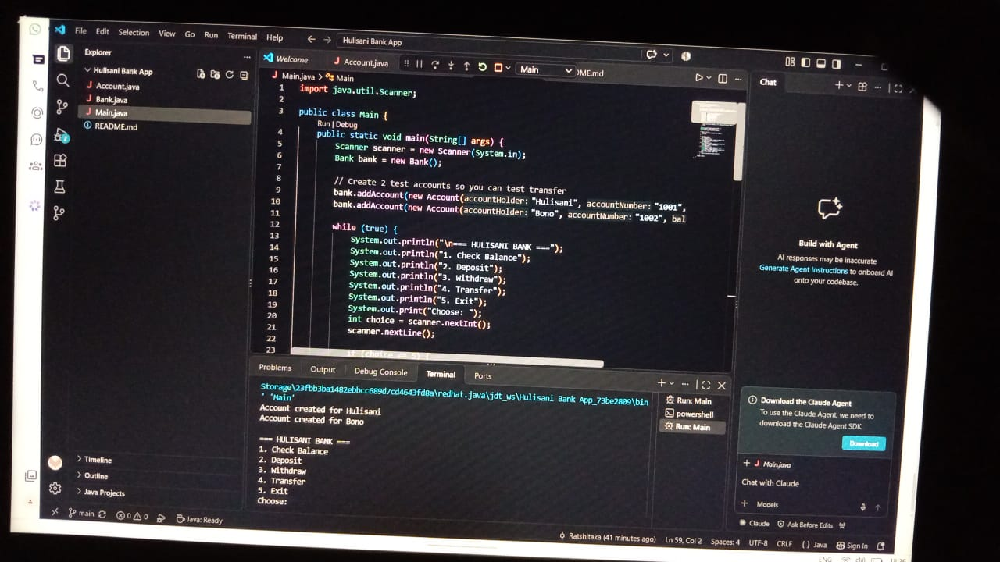

# Hulisani Banking App

A simple console-based Banking System built in Java.

## Features
- Create Account
- Check Balance
- Deposit Money
- Withdraw Money
- Transfer Between Accounts

## How to Run
1. Open in VS Code
2. Run Main.java
3. Use test accounts:
   - 1001 (Hulisani - R1000)
   - 1002 (Bono - R500)

## Screenshot

## Tech
- Java
- OOP (Encapsulation, Classes, ArrayList)

Built by [Hulisani Ratshitaka](https://www.linkedin.com/in/ratshitaka-hulisani-859142276)